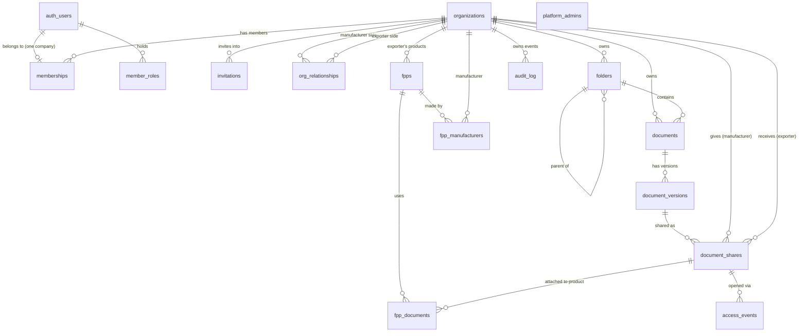

# CuraLex - DMS: Database schema

**Describes:** the PostgreSQL schema built by `supabase/migrations/` up to `20261128000000_document_details.sql` (2026-11-28).
**Related:** [`how-the-app-works.md`](./how-the-app-works.md), [`roles-and-permissions.md`](./roles-and-permissions.md), [`compliance-gap-assessment.md`](./compliance-gap-assessment.md), [`not-built-yet.md`](./not-built-yet.md)

This document is the reference for the data model: every table, column, constraint, index, read rule, write function, trigger and storage rule, plus how it maps to the planned Spring Boot rebuild (section 12).

---

## Contents

1. [Conventions](#1-conventions)
2. [Entity relationship diagram](#2-entity-relationship-diagram)
3. [Enumerations and allowed values](#3-enumerations-and-allowed-values)
4. [Tables](#4-tables)
5. [Indexes and uniqueness rules](#5-indexes-and-uniqueness-rules)
6. [Delete and cascade behaviour](#6-delete-and-cascade-behaviour)
7. [Read access (row-level security)](#7-read-access-row-level-security)
8. [Write functions](#8-write-functions)
9. [Triggers](#9-triggers)
10. [Audit log and hash chain](#10-audit-log-and-hash-chain)
11. [File storage](#11-file-storage)
12. [Mapping to the Spring Boot rebuild](#12-mapping-to-the-spring-boot-rebuild)
13. [Migration history](#13-migration-history)
14. [Planned schema changes](#14-planned-schema-changes)

---

## 1. Conventions

| Topic | Rule |
|---|---|
| Schema | Everything lives in `public`; users live in Supabase's `auth.users` (id, email, `email_confirmed_at`, `raw_user_meta_data` with `full_name` / `avatar_url`, `last_sign_in_at`). |
| Keys | `uuid` primary keys with `gen_random_uuid()`, except append-only logs (`access_events`, `audit_log`) which use `bigint generated always as identity` so their order is total. Join tables use composite primary keys. |
| Time | `timestamptz`, default `now()` (transaction time). The audit log uses `clock_timestamp()` so events in one transaction stay distinguishable. Expiry and issue dates of documents are calendar `date`s. |
| Emails | Stored lower-cased and trimmed; enforced by check constraints (`email = lower(btrim(email))`). |
| Names | Trimmed, length-checked; folder and file names may not contain `/` or `\`. Names are unique **case-insensitively** within their parent (`lower(name)`). |
| Soft delete | Folders, documents and versions are never physically deleted: `deleted_at` is set ("tombstone"). Names only need to be unique among non-deleted rows. Version numbers are never reused. |
| Writes | Clients (the browser, through PostgREST) can **only read**, through row-level security. **Every write goes through a `SECURITY DEFINER` function** that checks the caller (company, role/permission, state). |
| Function grants | Functions are granted to `anon` and `authenticated` and check the caller internally. `EXECUTE` is never revoked, because the local Postgres image (`supabase/postgres 17.12.0.000`) segfaults on "permission denied for function". |
| Errors | Functions raise short snake_case codes as the exception message (e.g. `not_allowed`, `folder_exists`); the app maps them to user messages. |
| `search_path` | Every function sets `search_path = ''` and schema-qualifies all names. |

---

## 2. Entity relationship diagram



In words:

- A **user** belongs to at most **one company** (`memberships.user_id` is the primary key) and holds one or more **roles** in it.
- A **company** (`organizations`) is a manufacturer or an exporter. Manufacturers and exporters are linked many-to-many by `org_relationships`.
- A manufacturer owns a **folder tree** and **documents**; each document has numbered **versions**; a version is **shared** with an exporter; every exporter view/download of a share is an **access event**.
- An exporter groups shared documents into **products** (`fpps`) with their manufacturers.
- **Platform admins** are identified by email and belong to no company.
- The **audit log** records every change to the tables above.

---

## 3. Enumerations and allowed values

| Where | Values | Notes |
|---|---|---|
| `org_type` (enum) | `manufacturer`, `exporter` | Company type |
| `document_versions.status` | `pending`, `ready` | Upload state: `pending` from reserve until the file is confirmed in storage |
| `access_events.action` | `view`, `download` | |
| `fpp_manufacturers.role` | `finished_product`, `api`, `excipient`, `packaging`, `other`, or null | Manufacturer's role for that product |
| `member_roles.role` | `admin`, `author`, `qa_approver`, `doc_controller`, `viewer`, `regulatory` | Valid roles per company type below |
| `documents.doc_type` | `coa`, `copp`, `gmp`, `licence`, `dmf`, `stability`, `be_study`, `specification`, `sop`, `validation`, `iso`, `other`, or null | Labels: Certificate of Analysis, Certificate of Pharmaceutical Product, GMP certificate, Manufacturing licence, Drug Master File, Stability data, Bioequivalence study, Specification / test method, Standard operating procedure, Validation report, ISO certificate, Other |
| `audit_log.operation` | `INSERT`, `UPDATE`, `DELETE` | |

**Valid roles per company type** (`_valid_roles`):

| Company type | Valid roles | Founder roles (`_founder_roles`, given to the first contact) |
|---|---|---|
| manufacturer | admin, author, qa_approver, doc_controller, viewer | admin, author, qa_approver, doc_controller |
| exporter | admin, regulatory, viewer | admin, regulatory |

**Permission → roles** (`_roles_for`, checked by `has_permission(perm)`):

| Permission | Manufacturer roles | Exporter roles |
|---|---|---|
| `documents.edit` (folders, uploads, versions, details) | author | – |
| `documents.delete` | qa_approver | – |
| `sharing.share` (share, change duration) | doc_controller | – |
| `sharing.revoke` | admin, qa_approver, doc_controller | – |
| `exporters.invite` | admin, doc_controller | – |
| `exporters.remove` | admin | – |
| `activity.view` (exporter views/downloads) | admin, qa_approver, doc_controller, viewer | – |
| `audit.view` | admin, qa_approver, doc_controller, viewer | admin, regulatory |
| `products.edit` | – | admin, regulatory |
| `documents.download` (exporter downloads) | – | admin, regulatory |
| `users.manage` (Team page) | admin | admin |

`has_permission()` is false for deactivated members and for users without a company.

---

## 4. Tables

Legend: **PK** primary key, **FK** foreign key, **NN** not null.

### 4.1 `organizations`: companies

| Column | Type | Rules | Meaning |
|---|---|---|---|
| `id` | uuid | PK, default `gen_random_uuid()` | |
| `name` | text | NN, trimmed length 1–200 | Company name as entered by the inviter |
| `type` | `org_type` | NN | manufacturer / exporter |
| `created_by` | uuid | FK `auth.users`, on delete set null | Who created it (platform admin or inviting manufacturer user) |
| `created_at` | timestamptz | NN, default now() | |

Companies are created only by `admin_invite_company()` and `invite_exporter()`, together with their first invitation.

### 4.2 `memberships`: user ↔ company

| Column | Type | Rules | Meaning |
|---|---|---|---|
| `user_id` | uuid | **PK**, FK `auth.users`, on delete cascade | One company per user |
| `org_id` | uuid | NN, FK `organizations`, on delete cascade | |
| `created_at` | timestamptz | NN, default now() | Joined at |
| `deactivated_at` | timestamptz | null = active | Set by a company admin; history is kept |
| `deactivated_by` | uuid | FK `auth.users`, on delete set null | |

Helpers `current_org_id()`, `current_manufacturer_org_id()`, `current_exporter_org_id()` return the caller's company only when the membership is **active**.

### 4.3 `member_roles`: roles a user holds

| Column | Type | Rules | Meaning |
|---|---|---|---|
| `user_id` | uuid | PK part, FK `auth.users`, on delete cascade | |
| `role` | text | PK part, check in the role list | |
| `granted_by` | uuid | FK `auth.users`, on delete set null | |
| `granted_at` | timestamptz | NN, default now() | |

Roles are company-scoped through the user's single membership.

### 4.4 `invitations`

| Column | Type | Rules | Meaning |
|---|---|---|---|
| `id` | uuid | PK | |
| `org_id` | uuid | NN, FK `organizations`, on delete cascade | Company the invitee will join |
| `email` | text | NN, lower-cased/trimmed, contains `@` | Google account email that may accept |
| `invited_by` | uuid | FK `auth.users`, set null | Inviting user |
| `invited_by_org_id` | uuid | FK `organizations`, set null | null = platform admin invite; the manufacturer's id when a manufacturer invited an exporter; the company's own id for colleague invites |
| `roles` | text[] | | Roles granted on acceptance; filled with founder roles by a trigger when null |
| `accepted_at` | timestamptz | null = pending | |
| `accepted_by` | uuid | FK `auth.users`, set null | |
| `created_at` | timestamptz | NN | |

Rule: **at most one pending invitation per email** (partial unique index). Acceptance happens on sign-in (`accept_invitation()`).

### 4.5 `org_relationships`: which exporters a manufacturer works with

| Column | Type | Rules | Meaning |
|---|---|---|---|
| `manufacturer_org_id` | uuid | PK part, FK `organizations`, cascade | |
| `exporter_org_id` | uuid | PK part, FK `organizations`, cascade | |
| `created_by` | uuid | FK `auth.users`, set null | |
| `created_at` | timestamptz | NN | |

Created by `invite_exporter()` (also when the exporter already exists: "linked_existing"); deleted by `remove_exporter()`. A manufacturer can only share with exporters it is linked to.

### 4.6 `platform_admins`: CuraLex staff

| Column | Type | Rules | Meaning |
|---|---|---|---|
| `email` | text | PK, lower-cased/trimmed | |
| `created_at` | timestamptz | NN | |

Inserted manually (SQL). A platform admin email can never be invited into a company (`admin_email`). Admins have **no document access**.

### 4.7 `folders`

| Column | Type | Rules | Meaning |
|---|---|---|---|
| `id` | uuid | PK | |
| `org_id` | uuid | NN, FK `organizations`, cascade | Owning manufacturer |
| `parent_id` | uuid | FK `folders`, cascade; null = top level | Nesting |
| `name` | text | NN, trimmed length 1–100, no `/` or `\` | Displayed with a trailing "/" |
| `created_by` | uuid | FK `auth.users`, set null | |
| `created_at` | timestamptz | NN | |
| `deleted_at` | timestamptz | null = live | Tombstone |

`folder_path(id)` returns the display path ("Quality / Certificates").

### 4.8 `documents`: one per file name in a folder

| Column | Type | Rules | Meaning |
|---|---|---|---|
| `id` | uuid | PK | |
| `org_id` | uuid | NN, FK `organizations`, cascade | |
| `folder_id` | uuid | FK `folders`, cascade; null = top level | |
| `name` | text | NN, trimmed length 1–200, no `/` or `\` | File name incl. extension |
| `created_by` | uuid | FK `auth.users`, set null | |
| `created_at` | timestamptz | NN | |
| `deleted_at` | timestamptz | null = live | Tombstone |
| `doc_type` | text | check in the type list, nullable | Document type |
| `product` | text | ≤ 200 | Product name (free text, suggested from existing values) |
| `market` | text | ≤ 100 | Target market |
| `issued_by` | text | ≤ 200 | Issuing authority |
| `reference_no` | text | ≤ 100 | Certificate / reference number |
| `issue_date` | date | | |
| `expiry_date` | date | `issue_date <= expiry_date` when both set | Drives expiry warnings |

Uploading a file whose name already exists in the folder (case-insensitive) adds a **version** to the existing document instead of creating a new one. Details apply to the document across all versions.

### 4.9 `document_versions`

| Column | Type | Rules | Meaning |
|---|---|---|---|
| `id` | uuid | PK | |
| `document_id` | uuid | NN, FK `documents`, cascade | |
| `version` | int | NN, > 0; unique with `document_id` | 1, 2, 3… never reused |
| `storage_path` | text | NN, **unique** | Object key in the `documents` bucket |
| `status` | text | `pending` / `ready`, default `pending` | Upload state |
| `size_bytes` | bigint | | Set on completion |
| `mime_type` | text | | Set on completion |
| `uploaded_by` | uuid | FK `auth.users`, set null | |
| `created_at` | timestamptz | NN | |
| `deleted_at` | timestamptz | null = live | Tombstone |

Only `ready`, non-deleted versions are listed or shareable.

### 4.10 `document_shares`: a version shared with an exporter

| Column | Type | Rules | Meaning |
|---|---|---|---|
| `id` | uuid | PK | Used in the secure access URL |
| `version_id` | uuid | NN, FK `document_versions`, cascade | |
| `manufacturer_org_id` | uuid | NN, FK `organizations`, cascade | Giver |
| `exporter_org_id` | uuid | NN, FK `organizations`, cascade | Receiver |
| `expires_at` | timestamptz | null = no expiry | Access end; 1–3650 days from share/duration change |
| `revoked_at` | timestamptz | null = not revoked | |
| `created_by` | uuid | FK `auth.users`, set null | |
| `created_at` | timestamptz | NN | Shared at |

**Share states:** *live* (`revoked_at` null and (`expires_at` null or in the future)), *expired* (`expires_at` past, not revoked; still listed to the exporter as expired), *revoked* (hidden from the exporter, kept for audit). At most **one non-revoked share per version and exporter** (partial unique index); re-sharing updates its duration.

### 4.11 `access_events`: exporter views and downloads (append-only)

| Column | Type | Rules | Meaning |
|---|---|---|---|
| `id` | bigint | PK, identity | |
| `share_id` | uuid | NN, FK `document_shares`, cascade | |
| `version_id` | uuid | NN, FK `document_versions`, cascade | Snapshot for reporting |
| `manufacturer_org_id` | uuid | NN, FK `organizations`, cascade | |
| `exporter_org_id` | uuid | NN, FK `organizations`, cascade | |
| `user_id` | uuid | FK `auth.users`, set null | |
| `user_email` | text | | Snapshot (survives user deletion) |
| `action` | text | `view` / `download` | |
| `created_at` | timestamptz | NN | |

Written only by `record_document_access()`, which is called by the app server before it issues a short-lived signed URL.

### 4.12 `fpps`: exporter products (UI label "Products")

| Column | Type | Rules | Meaning |
|---|---|---|---|
| `id` | uuid | PK | |
| `exporter_org_id` | uuid | NN, FK `organizations`, cascade | Owner |
| `name` | text | NN, trimmed length 1–200; unique per exporter (case-insensitive) | e.g. "Paracetamol 500 mg Tablets" |
| `details` | text | ≤ 500 | Market, pack, registration number… |
| `created_by` | uuid | FK `auth.users`, set null | |
| `created_at` | timestamptz | NN | |

### 4.13 `fpp_manufacturers`

| Column | Type | Rules | Meaning |
|---|---|---|---|
| `fpp_id` | uuid | PK part, FK `fpps`, cascade | |
| `manufacturer_org_id` | uuid | PK part, FK `organizations`, cascade | Must be a manufacturer linked to the exporter |
| `role` | text | role list or null | |
| `added_at` | timestamptz | NN | |

### 4.14 `fpp_documents`

| Column | Type | Rules | Meaning |
|---|---|---|---|
| `fpp_id` | uuid | PK part, FK `fpps`, cascade | |
| `share_id` | uuid | PK part, FK `document_shares`, cascade | Documents are attached **by reference to the share**, not copied; if the share is revoked the product shows it as "no longer available" |
| `added_at` | timestamptz | NN | |

### 4.15 `audit_log`

| Column | Type | Meaning |
|---|---|---|
| `id` | bigint, identity, PK | Total order of events |
| `at` | timestamptz, default `clock_timestamp()` | When |
| `actor_user_id` | uuid (no FK, survives deletion) | Who |
| `actor_email` | text | Snapshot of who |
| `actor_org_id` | uuid | Actor's company at the time |
| `org_id` | uuid | Company that owns the record (visibility) |
| `related_org_id` | uuid | Other party (e.g. exporter of a share), also gets visibility |
| `action` | text, NN | e.g. `share.revoked` (list in section 10) |
| `table_name` | text, NN | Source table |
| `operation` | `INSERT`/`UPDATE`/`DELETE` | |
| `record_id` | text | Primary key of the changed row (or `user_id` for membership/role rows) |
| `subject_document_id` | uuid | Groups events per document (versions, shares, access) |
| `subject_name` | text | Human label snapshot ("CoA.pdf v2 → Tarangini") |
| `old_data`, `new_data` | jsonb | Full row before/after |
| `changed_fields` | text[] | Keys whose values changed |
| `reason` | text | Reason sent with the request (required for deletes, revocations, exporter removal) |
| `prev_hash`, `row_hash` | text | SHA-256 hash chain (section 10) |

Append-only: triggers block `UPDATE`, `DELETE` and `TRUNCATE`.

---

## 5. Indexes and uniqueness rules

| Index | Definition | Purpose |
|---|---|---|
| `memberships_org_id_idx` | `memberships(org_id)` | Members of a company |
| `invitations_one_pending_per_email` | unique `invitations(email) where accepted_at is null` | One pending invitation per email |
| `invitations_org_id_idx` | `invitations(org_id)` | |
| `org_relationships_exporter_idx` | `org_relationships(exporter_org_id)` | Exporter → manufacturers |
| `folders_unique_name` | unique `folders(org_id, coalesce(parent_id, zero-uuid), lower(name)) where deleted_at is null` | Case-insensitive unique folder names per parent |
| `documents_unique_name` | unique `documents(org_id, coalesce(folder_id, zero-uuid), lower(name)) where deleted_at is null` | Same file name → new version |
| `documents_expiry_idx` | `documents(org_id, expiry_date) where deleted_at is null and expiry_date is not null` | Expiry queries |
| `document_versions` unique | `(document_id, version)`, `storage_path` | |
| `document_shares_one_live` | unique `document_shares(version_id, exporter_org_id) where revoked_at is null` | One live share per version and exporter |
| `document_shares_manufacturer_idx` / `_exporter_idx` | by org | Listing shares |
| `access_events_share_idx` / `_manufacturer_idx` / `_exporter_idx` | `(…, created_at desc)` | Activity lists |
| `fpps_unique_name` | unique `fpps(exporter_org_id, lower(name))` | |
| `fpp_documents_share_idx` | `fpp_documents(share_id)` | Share → products |
| `audit_log_org_idx` / `_related_idx` / `_document_idx` | `(…, id desc)` | Audit trail paging and per-document history |

---

## 6. Delete and cascade behaviour

- **Application deletes are soft.** `delete_documents`, `delete_version` and `delete_folder` set `deleted_at` on the affected rows (a folder delete covers its whole subtree), **revoke every live share** of the affected versions, and return the storage paths so the app server removes the files from storage. A document whose last version is deleted is deleted too.
- **Impact preview:** `delete_impact(document_ids, folder, version)` returns counts (files, versions, live shares, exporters affected) for the confirmation dialog.
- **Exporter removal:** `remove_exporter` revokes all live shares to that exporter, removes the manufacturer from the exporter's products (`fpp_manufacturers` rows and attached `fpp_documents` of its shares), and deletes the `org_relationships` row. Share rows and access events stay.
- **Database cascades** (`on delete cascade`) exist for referential integrity but are not used by the app in normal operation (companies are never deleted). User deletion in `auth.users` sets actor columns to null; snapshots (`user_email`, `actor_email`) preserve the record.
- **Never deleted:** `audit_log` (blocked by trigger), `access_events` (no delete path).

---

## 7. Read access (row-level security)

All tables have RLS enabled; there are **no insert/update/delete policies**, so direct writes are impossible.

| Table | Who can read |
|---|---|
| `organizations` | Own company, companies related through `org_relationships`, platform admins all |
| `memberships` | Own row; platform admins all |
| `member_roles` | Members of the same company; platform admins |
| `invitations` | Invitations your company sent (`invited_by_org_id`); platform admins |
| `org_relationships` | Rows involving your company; platform admins |
| `folders`, `documents` | Own company, non-deleted only |
| `document_versions` | Versions of own company's non-deleted documents, non-deleted only |
| `document_shares` | Shares your company gave or received |
| `access_events` | Events of shares your company gave or received |
| `fpps`, `fpp_manufacturers`, `fpp_documents` | The owning exporter only |
| `audit_log` | Platform admins; otherwise rows where `org_id` or `related_org_id` is your company **and** you have `audit.view` |
| `platform_admins` | Nobody directly (checked through `is_platform_admin()`) |

Exporters never read manufacturers' `documents`/`document_versions` tables; they use `my_shared_documents()`.

---

## 8. Write functions

All are `SECURITY DEFINER`. "Reason" = the request must carry an audit reason (base64 in the `x-audit-reason` header), otherwise `reason_required`; the reason is checked after the permission check.

### 8.1 Account, invitations and team

| Function | Who | Does | Errors |
|---|---|---|---|
| `my_account()` | anyone signed in | Returns `{email, is_admin, org{id,name,type}, roles[], permissions[], deactivated}` | |
| `accept_invitation()` | anyone signed in | If the user has no membership and a pending invitation matches their confirmed email: creates the membership, grants the invitation's roles (filtered to valid roles), marks it accepted. Returns `my_account()` | |
| `admin_invite_company(name, email, type)` | platform admin | Creates the company and its invitation | `not_allowed`, `admin_email`, `invalid_input`, `already_member`, `already_invited` |
| `admin_list_companies()` | platform admin | Companies with contact email, status (`invited`/`active`), invited_at, inviting company | `not_allowed` |
| `invite_exporter(company, email)` | `exporters.invite` | New email → creates exporter company + invitation (`invited`); existing exporter member or pending invite → links it (`linked_existing`). Creates `org_relationships`. Returns `{status, org_id, org_name, email}` | `not_allowed`, `admin_email`, `invalid_input`, `not_an_exporter`, `already_linked` |
| `my_exporters()` | manufacturer | Linked exporters with contact email, status, linked_at | |
| `my_manufacturers()`, `my_manufacturer_options()` | exporter | Linked manufacturers | |
| `remove_exporter(exporter)` | `exporters.remove`, reason | See section 6; returns number of revoked shares | `not_allowed`, `not_found`, `reason_required` |
| `invite_colleague(email, roles[])` | `users.manage` | Invitation into own company with given roles | `invalid_input`, `admin_email`, `already_member`, `already_invited`, `roles_required`, `invalid_role` |
| `set_member_roles(user, roles[])` | `users.manage` | Replaces a member's roles | `last_admin`, `roles_required`, `invalid_role`, `not_found` |
| `set_member_active(user, active)` | `users.manage` | Deactivates / reactivates | `cannot_change_self`, `last_admin`, `not_found` |
| `cancel_invitation(invitation)` | `users.manage` | Deletes a pending invitation of own company | `not_found` |
| `my_team()` | `users.manage` | Members (email, name, roles, active, joined, last sign-in, is_me) and pending invitations | |
| `my_roles()`, `has_permission(perm)` | anyone | Role/permission lookup for the caller | |

### 8.2 Documents

| Function | Who | Does | Errors |
|---|---|---|---|
| `create_folder(parent, name)` | `documents.edit` | Creates a folder | `invalid_name`, `folder_exists`, `not_found` |
| `reserve_upload(folder, file_name)` | `documents.edit` | Finds or creates the document (case-insensitive name), creates a `pending` version with the next number, returns `{version_id, version, storage_path}` | `invalid_name`, `not_found` |
| `complete_upload(version, size, mime)` | `documents.edit` | Checks the object exists in storage, marks the version `ready` | `not_found`, `file_missing` |
| `set_document_details(document, details jsonb)` | `documents.edit` | Sets all detail fields (missing keys cleared, blanks → null) | `invalid_details`, `invalid_date`, `expiry_before_issue`, `not_found` |
| `delete_documents(ids[])`, `delete_version(version)`, `delete_folder(folder)` | `documents.delete`, reason | Soft delete + revoke shares; return storage paths | `not_allowed`, `not_found`, `reason_required` |
| `delete_impact(...)` | company member | Counts for the confirmation dialog | |
| `can_remove_storage_object(name)` | (storage policy helper) | True when the object belongs to a deleted version of the caller's company | |

### 8.3 Sharing and exporter access

| Function | Who | Does | Errors |
|---|---|---|---|
| `share_versions(exporter, items jsonb[{version_id, days}])` | `sharing.share` | Creates shares (or updates the duration of an existing live share); `days` 1–3650 or null for no expiry | `not_your_exporter`, `nothing_selected`, `invalid_duration`, `not_found` |
| `set_share_duration(share, days)` | `sharing.share` | Recomputes `expires_at` from now | `invalid_duration`, `not_found` |
| `revoke_shares(ids[])` | `sharing.revoke`, reason | Sets `revoked_at` | `not_found`, `reason_required` |
| `my_shared_documents()` | exporter | Non-revoked shares with file, folder path, version, size, MIME, shared/expiry, `expired`, `doc_type`, `product`, `document_expiry`, `latest_version` | |
| `record_document_access(share, action)` | exporter; `documents.download` for downloads | Checks the share is live and the version/document not deleted, appends an `access_events` row, returns `{storage_path, file_name, mime_type}` | `no_access`, `invalid_action`, `not_allowed` |

### 8.4 Products (exporter)

| Function | Who | Does | Errors |
|---|---|---|---|
| `create_fpp(name, details)`, `update_fpp(...)`, `delete_fpp(id)` | `products.edit` | Product CRUD | `invalid_name`, `fpp_exists`, `not_found` |
| `add_fpp_manufacturer(fpp, manufacturer, role)`, `remove_fpp_manufacturer(...)` | `products.edit` | Only linked manufacturers; role from the role list | `not_your_manufacturer`, `not_found` |
| `add_fpp_documents(fpp, share_ids[])`, `remove_fpp_document(fpp, share)` | `products.edit` | Only shares received by the exporter | `not_found` |

### 8.5 Audit

| Function | Who | Does |
|---|---|---|
| `verify_audit_chain()` | platform admin | Recomputes the hash chain; returns `{ok, checked, broken_at?}` |
| `_audit_append(...)` | triggers only (`pg_trigger_depth() = 0` → `not_allowed`) | Appends a hashed row |

---

## 9. Triggers

| Trigger | On | Does |
|---|---|---|
| `audit_<table>` (after insert/update/delete, per row) | folders, documents, document_versions, document_shares, access_events, org_relationships, invitations, memberships, organizations, platform_admins, fpps, fpp_manufacturers, fpp_documents, member_roles | `_audit_trigger()`: decides the action label, owner/related company, document and subject name; calls `_audit_append()` |
| `audit_log_no_update` (before update/delete) and `audit_log_no_truncate` | audit_log | Raise an error: the log is immutable |
| `invitations_default_roles` (before insert) | invitations | Fills `roles` with the founder roles of the company type when null |

Pending upload reservations (`document_versions` insert) are not logged; the version is logged once its upload completes (`version.uploaded`).

---

## 10. Audit log and hash chain

**Action labels** written by `_audit_trigger()`:

| Table | Actions |
|---|---|
| folders | `folder.created`, `folder.deleted`, `folder.renamed`, `folder.updated` |
| documents | `document.created`, `document.deleted`, `document.renamed`, `document.updated` (incl. details changes) |
| document_versions | `version.uploaded`, `version.deleted`, `version.moved`, `version.updated` |
| document_shares | `share.created`, `share.revoked`, `share.duration_changed`, `share.updated` |
| access_events | `document.viewed`, `document.downloaded` |
| org_relationships | `exporter.connected`, `exporter.removed` |
| invitations | `invitation.created`, `invitation.accepted`, `invitation.deleted`, `invitation.updated` |
| memberships | `member.added`, `member.removed`, `member.deactivated`, `member.reactivated`, `member.updated` |
| member_roles | `member.role_added`, `member.role_removed` |
| organizations, platform_admins, fpps, fpp_* | `<table>.created/updated/deleted`-style labels |

**Hash chain:** appends are serialised with `pg_advisory_xact_lock`. Each row stores the previous row's hash and

```
row_hash = sha256_hex( prev_hash | at | actor_user_id | actor_email | action | table_name | operation
                       | record_id | old_data::text | new_data::text | reason )
```

(fields joined with `|`, nulls as empty strings, UTF-8). `verify_audit_chain()` recomputes every row and reports the first break. Editing or deleting any row (bypassing the triggers as a superuser) breaks the chain from that point.

**Reasons:** the app sends the reason base64-encoded in the `x-audit-reason` request header; `_audit_reason()` reads it from PostgREST's `request.headers`, and `_require_reason()` enforces it for deletes, revocations and exporter removal.

---

## 11. File storage

- **Bucket:** `documents`, private, 50 MB per file.
- **Object key:** `<org_id>/<Folder>/<Sub folder>/<File name>/v<N><.ext>`, path segments made storage-safe by `storage_safe()`; the database keeps the real display names. Keys use the document's stored name, so later renames don't move objects.
- **Upload flow:** `reserve_upload()` → browser uploads directly to the reserved key → `complete_upload()` confirms the object exists.
- **Storage policies:**
  - *insert:* only to a key reserved as a `pending` version of the caller's company (`documents.edit`);
  - *select:* manufacturers read objects under their own `<org_id>/` prefix;
  - *delete:* only objects of deleted versions of the caller's company (`can_remove_storage_object`).
- **Exporters never read storage directly:** the app server calls `record_document_access()` and then issues a 60-second signed URL with a service-role client.

---

## 12. Mapping to the Spring Boot rebuild

The rebuild (Angular + Spring Boot, repo `krylox-llp/dms`) keeps the **same data model and rules**; what changes is *where* they are enforced.

| Today (Supabase) | Rebuild (Spring Boot + PostgreSQL) |
|---|---|
| `auth.users` (Supabase Auth, Google OAuth) | Own `users` table: `id uuid`, `email` (unique, lower-case), `email_verified`, `google_subject` (unique), `full_name`, `avatar_url`, `created_at`, `last_sign_in_at`. Upserted on each Google sign-in. All `auth.users` FKs point here. |
| RLS policies for reads | Service-layer queries always scoped by the caller's company (and permission); repository methods take the company id explicitly. Optionally keep RLS as defence in depth with `SET LOCAL app.user_id/app.org_id` per transaction. |
| `SECURITY DEFINER` write functions | Spring services (one per area), `@Transactional`, permission check first, then state checks, then writes. Error codes stay identical (`not_allowed`, `folder_exists`, …) and are returned as RFC 9457 problem details with a `code` field. |
| `has_permission()` / `_roles_for()` | A `PermissionService` with the same role→permission map (section 3); `/api/me` returns `roles` and `permissions` exactly as `my_account()` does. |
| Audit triggers + `_audit_append()` | **Keep in the database** (triggers + hash chain + immutability) so no code path can skip them. The service sets `SET LOCAL app.user_id`, `app.user_email`, `app.org_id` and `app.audit_reason` at the start of each write transaction; the trigger reads them instead of the JWT/header. |
| `x-audit-reason` header | A `reason` field in the request body for the endpoints that require it; validated in the service, passed to the trigger via `app.audit_reason`. |
| Supabase Storage + policies | S3-compatible storage (AWS S3 / MinIO locally). Uploads via **pre-signed PUT URLs** issued after `reserve`; downloads via pre-signed GET URLs issued only after the permission/access check. Same key layout. |
| PostgREST reads (`.from(...)`) | REST endpoints returning DTOs; no direct table access from the browser. |
| Migrations in `supabase/migrations` | Flyway migrations, one per feature area, same order. |
| Grants to anon/authenticated (local crash workaround) | Not needed: the application connects as a single DB role; no function-level grants. |

Things to keep exactly: case-insensitive unique names with tombstones, version numbering, one live share per version/exporter, durations 1–3650 days, share states, reasons for deletes/revokes/removals, founder roles, last-admin and cannot-change-self rules, the audit action labels and hash formula.

---

## 13. Migration history

| # | File | Adds |
|---|---|---|
| 1 | `20261127000000_organizations_and_invitations.sql` | org_type, organizations, memberships, invitations, org_relationships, platform_admins; helpers; invite/accept/list functions |
| 2 | `20261127010000_admin_guard_and_grants.sql` | `admin_email` guard, `invite_exporter`, grants |
| 3 | `20261127020000_documents_and_shares.sql` | folders, documents, document_versions, document_shares; storage bucket and policies; upload and share functions |
| 4 | `20261127030000_delete_documents.sql` | `deleted_at` tombstones, partial unique names, delete functions, storage delete policy |
| 5 | `20261127040000_exporter_access.sql` | access_events, `my_shared_documents`, `record_document_access` |
| 6 | `20261127050000_exporter_fpps.sql` | fpps, fpp_manufacturers, fpp_documents and functions |
| 7 | `20261127060000_remove_exporter.sql` | `remove_exporter` |
| 8 | `20261127080000_audit_trail.sql` | audit_log, triggers, hash chain, reasons, `verify_audit_chain` |
| 9 | `20261127090000_roles.sql` | member_roles, deactivation, invitation roles, permissions in every write function, team functions |
| 10 | `20261128000000_document_details.sql` | document details columns, `set_document_details`, details in `my_shared_documents` |

(`070_rename` exists only in a git stash.)

---

## 14. Planned schema changes

From [GitHub issue #1](https://github.com/krylox-llp/curalex-dms-demo/issues/1) and [`not-built-yet.md`](./not-built-yet.md):

- **Approvals:** `document_versions.lifecycle` (`draft`, `submitted`, `approved`, `rejected`, `superseded`), `sha256`, a partial unique index "one approved version per document", an append-only `signatures` table (version, signer, printed name, email, meaning, comment, signed_at, sha256, auth_time), permission `documents.approve` (qa_approver), and a platform setting for the re-authentication window.
- **Retire instead of delete:** `retired_at` / `retired_by` / reason on documents and versions; retention policy per document type; legal hold.
- **Per-share access mode:** `document_shares.mode` (`view` / `download`).
- **Document requests:** a `document_requests` table (exporter → manufacturer, product, due date, status).
- **Sessions/MFA and sign-in events** in the audit log.
